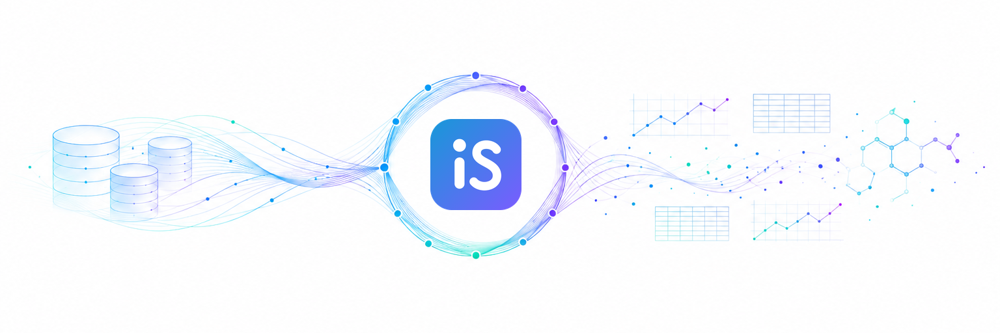

  

<h3 align="center">Ask a question. Get an original study, mined from open databases.</h3>

  <a href="https://itersci.ai">Website</a> ·
  <a href="https://huggingface.co/itersci">Hugging Face</a> ·
  <a href="mailto:victor@itersci.ai">Contact</a>

---

IterSCI is an AI for Science platform. Its agents run the research loop end to end: literature, hypothesis, data, analysis, reproducible paper.

**How every study runs**

1. Start from a question people care about.
2. Find the public datasets that can answer it, such as NHANES, GBD, OpenAlex and GH Archive.
3. Preregister the analysis plan before touching the data.
4. Run the analysis, correct for multiple comparisons, and report the result whichever way it falls.
5. Release the paper, code and data sources together.

Studies are published here as they are released. Try your own question at [itersci.ai](https://itersci.ai).
